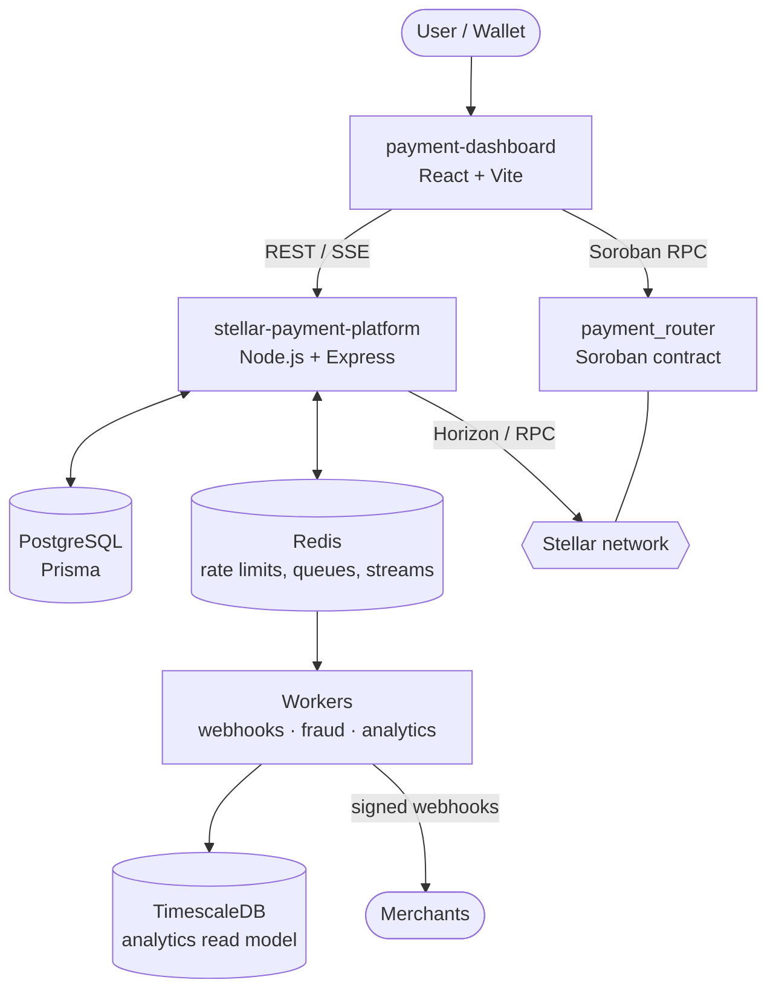

<div align="center">

# Stellar Tags

**Human-readable payment tags for the Stellar network.**
Send to `alice*stellartags` instead of a 56-character `G...` address.

[](https://github.com/Abdulazeem-code/stellar-tags/actions/workflows/ci.yml)
[](LICENSE)


[Quick start](#quick-start) · [Architecture](#architecture) · [Documentation](#documentation) · [Contributing](#contributing)

</div>

---

## What is Stellar Tags?

Stellar addresses are long and easy to get wrong. Stellar Tags lets anyone claim a
short username, a **tag**, and get paid to it. Under the hood it is a full
payment stack:

- a **Soroban smart contract** that routes payments, takes platform fees, swaps
  tokens through DEXes and refunds payments that cannot be delivered,
- a **Node.js API** that runs a [SEP-0002 federation](https://developers.stellar.org/docs/learn/encyclopedia/network-configuration/federation)
  server, merchant webhooks, analytics and fraud checks,
- a **React dashboard** where users connect a wallet, claim a tag, and send or
  receive payments.

## Features

| | |
| --- | --- |
| 🏷️ **Username tags** | Claim `name*domain`, keep up to 5 aliases per address, resolve both ways via SEP-0002 federation. |
| ⚡ **On-chain routing** | `route_payment`, batch payments, split payments and multi-hop swaps in one Soroban contract. |
| 🔁 **Token swaps** | Pay in one asset, deliver another, with slippage limits and DEX adapters. |
| ↩️ **Safe refunds** | Undeliverable payments go to a refund balance the sender can claim later, instead of aborting the transaction. |
| 🔐 **Hardened admin** | Role-based access, timelocked actions, M-of-N multisig upgrades, emergency freeze, a dead man's switch. |
| 🗳️ **Fee governance** | Token-weighted proposals and votes for changing fees. |
| 🔔 **Merchant webhooks** | HMAC-signed deliveries, retries with backoff, a dead letter queue with replay. |
| 📡 **Live status** | Server-Sent Events stream for payment status updates. |
| 📊 **Observability** | Prometheus metrics, Grafana dashboard, structured logs, audit logs, CQRS analytics on TimescaleDB. |
| 🕶️ **Research** | Zero-knowledge private payments (Groth16 / BLS12-381), flash loans, yield escrow, TWAP oracle. |

## Architecture



1. The user opens the dashboard and connects a Stellar wallet.
2. The dashboard asks the API to register a tag or resolve one to an address.
3. The API stores tags in PostgreSQL and serves them over federation.
4. Payments are signed in the wallet and routed through the `payment_router` contract.
5. The Horizon listener picks up the result, pushes live updates to the dashboard,
   and queues signed webhooks for merchants.

## Repository layout

| Path | What it is |
| --- | --- |
| [`payment-dashboard/`](payment-dashboard) | React + Vite frontend: landing, registration, send/receive, history, analytics |
| [`stellar-payment-platform/`](stellar-payment-platform) | Node.js API, Prisma schema, background workers (webhooks, fraud, analytics, outbox) |
| [`payment_router/`](payment_router) | Main Soroban contract: routing, fees, swaps, refunds, governance, upgrades |
| [`payment_proxy/`](payment_proxy) | Upgradeable proxy contract |
| [`timelock_escrow/`](timelock_escrow) · [`yield_escrow/`](yield_escrow) | Escrow contracts |
| [`flash_loan/`](flash_loan) · [`twap_oracle/`](twap_oracle) · [`pausable_token/`](pausable_token) | Supporting DeFi contracts |
| [`zk_payment/`](zk_payment) | Zero-knowledge private payment contract and circuit (research, testnet only) |
| [`packages/types/`](packages/types) | TypeScript bindings generated from the `payment_router` ABI |
| [`contracts/`](contracts) | Solidity bridge for Axelar cross-chain payments |
| [`scripts/`](scripts) | Contract build, deploy and upgrade CLI, binding generation |
| [`tests/integration/`](tests/integration) | Contract integration tests against a local Stellar node |
| [`docs/`](docs) | Guides and reference |

## Quick start

**You need:** Node 22, Docker, and (for contracts) Rust stable with the
`wasm32-unknown-unknown` target and the [`stellar` CLI](https://developers.stellar.org/docs/tools/cli).

```bash
git clone https://github.com/Abdulazeem-code/stellar-tags.git
cd stellar-tags
```

**1. Start Postgres, Redis and the API**

```bash
docker compose --profile dev up -d
```

Or run the API outside Docker:

```bash
cd stellar-payment-platform
npm install
cp .env.example .env        # set DATABASE_URL
npm run prisma:migrate
npm run db:seed             # 50 users, webhooks, payment intents, API keys
npm run dev                 # http://localhost:5000
```

**2. Start the dashboard**

```bash
cd payment-dashboard
npm install
echo "VITE_API_BASE=http://localhost:5000" > .env
npm run dev                 # http://localhost:3000
```

**3. Build and test the contracts**

```bash
cargo test --workspace
```

**4. Try it**

```bash
curl http://localhost:5000/health
curl "http://localhost:5000/users?limit=5"                          # pick a seeded username
curl "http://localhost:5000/federation?q=<username>*localhost&type=name"
```

See the [development guide](docs/development.md) for every Compose profile,
database options, seed data details and deployment to Render.

## Running tests

| Area | Command |
| --- | --- |
| Dashboard | `npm --prefix payment-dashboard run lint` and `run build` (no unit tests yet) |
| API | `npm --prefix stellar-payment-platform test` |
| Contracts | `cargo test --workspace` |
| Contract integration | `npm run test:integration` (needs `docker compose --profile integration up`) |
| Load test | `npm run load:test` |
| Lint | `npm run lint` |

CI runs lint, the frontend build, API unit and integration tests with coverage
thresholds, `rustfmt` / `clippy`, contract tests, and a check that the generated
TypeScript bindings still match the contract.

## Documentation

**Guides**

- [Development guide](docs/development.md): Compose profiles, database, seed data, tests, Render deployment
- [Configuration](docs/configuration.md): environment variables, logging, internal mTLS
- [Smart contracts](docs/smart-contracts.md): refunds, swaps, governance, deployment, multisig upgrades
- [API reference](docs/api-reference.md): endpoints, error codes, validation, SSE, DLQ, metrics

**Deep dives**

- [Analytics (CQRS)](docs/analytics-cqrs.md) · [Observability and fraud](docs/observability-and-fraud.md) · [Grafana dashboard](docs/grafana-dashboard.md)
- [Webhook signature verification](docs/webhook-signature-verification.md) · [mTLS](docs/mtls.md)
- [DEX token swaps](docs/dex-token-swaps.md) · [Flash loans](docs/flash-loans.md) · [Data archival](docs/data-archival.md)
- [ZK private payments](docs/zk-private-payments.md) · [ZK routing research](docs/research-zk-anonymous-routing.md)
- [Cross-chain setup](CROSS_CHAIN_SETUP.md) · [Axelar integration](AXELAR_INTEGRATION.md)
- [Postman collection](docs/api-collections/Stellar-Tags-API.postman_collection.json)

## Deployment

- **API + database:** the [`render.yaml`](render.yaml) blueprint deploys the API with a managed
  PostgreSQL database. Migrations run on boot.
- **Dashboard:** any static host (for example Vercel) with `VITE_API_BASE` pointing at the API.
- **Contracts:** `./scripts/deploy_contract.sh deploy --network testnet` builds, optimizes,
  deploys and writes the new contract ID into both `.env` files. Upgrades need an M-of-N
  signer group; see [Smart contracts](docs/smart-contracts.md#multisig-contract-upgrades).

> ⚠️ Stellar Tags has not been audited. The ZK setup in `zk_payment/` is for tests
> only. Do not use it with real funds.

## Contributing

Contributions are welcome. Please read [CONTRIBUTING.md](CONTRIBUTING.md) first.
Pre-commit hooks run ESLint and `prisma validate`, and CI must pass before a PR is merged.

1. Fork the repo and create a branch: `git checkout -b feat/my-feature`
2. Make your change, with tests
3. Run `npm run lint` and the relevant test suites
4. Open a pull request against `main`

## License

[GPL-3.0](LICENSE)
